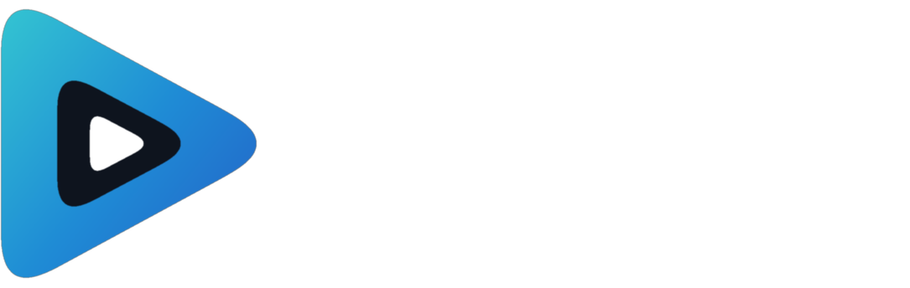

  

  
Munk Stream TV: app streaming Maerz untuk Android TV dan TV box.

  [Muat turun versi terbaru](https://github.com/maerzmunk/munk-stream-tv/releases/latest)

## Pasang

Buka [Releases](https://github.com/maerzmunk/munk-stream-tv/releases/latest) dan pilih APK:

- `armeabi-v7a`: kebanyakan Android TV dan TV box (Mi TV, Mi Box, Mi TV Stick). Pilih ini jika tak pasti.
- `arm64-v8a`: TV box 64-bit (contohnya Nvidia Shield, Google TV Streamer).

Lepas pasang, app akan beritahu sendiri bila ada versi baru.

Untuk telefon, guna [Munk Stream](https://github.com/maerzmunk/munk-stream).

## Kredit dan lesen

Munk Stream TV dibina atas [Nuvio TV](https://github.com/NuvioMedia/NuvioTV) oleh NuvioMedia,
dengan jenama, logo dan tetapan diubah. Kod asal dan kod ini dilesenkan di bawah GPL-3.0
(lihat [LICENSE](LICENSE)). README asal Nuvio ada di [NUVIO-README.md](NUVIO-README.md).
